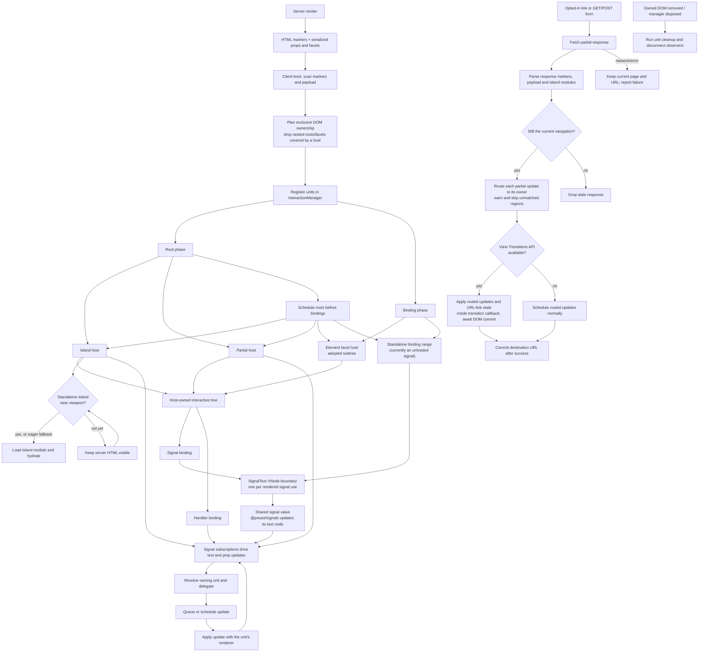

# Hum

[](https://hum.runasp.net/)
[](https://hum-docs.oaly2000.workers.dev/)

Hum is a server-side rendering framework built on [Preact](https://preactjs.com)
and [Hono](https://hono.dev).

Hum's Vite build requires Node.js 20.19 or later (or 22.12 or later). Workspace
development and the precompiled documentation site require Node.js 22.18 or
later and pnpm.

Most of its inspiration and a good part of its code come from
[Fresh](https://usefresh.dev). It keeps Fresh's distinctive
[Partial](https://usefresh.dev/docs/advanced/partials) mechanism and adds a few
improvements and features of its own.

## Getting started

```sh
pnpm dlx create-hum my-app     # or: npm create hum@latest my-app
cd my-app
npm install
npm run dev
```

This starts the Vite development server. Open the URL it prints, then edit
`routes/index.tsx` to change the home page. The generated project also includes
a `Counter` island, example route handlers, and Tailwind CSS. For a guided
walkthrough, see the [getting started guide](https://hum.runasp.net/docs/getting-started).

Build and run the generated Node app with:

```sh
npm run build
npm start
```

The scaffold generates a project like this:

```
routes/
  _app.tsx       document shell (html/head/body) + default head tags
  _404.tsx       not found page
  index.tsx      /
  ...
islands/
  Counter.tsx    interactive component
client/
  main.ts        client entry; imports global CSS
  style.css      global styles
public/          served from / in dev; copied into the build's public/
app.ts           Hono app with middleware, APIs and explicit Hum mounting
server.ts        Node entry; calls serve()
vite.config.ts   plugins: [hum({ devEntry: "app.ts" }), tailwindcss()]
```

Projects use Vite for dev/build, and the build output runs with
`node dist/server.js`. By default, server code is compiled to ESM modules and
npm dependencies stay external, so deploy the output with the application's
production dependencies installed. Native modules and packages that read their
own resources keep using Node's normal package resolution.

```
dist/                 the output directory; `outDir` in the plugin options
  server.js           the compiled server entry
  app.js              the compiled Hono application
  routes/             compiled route modules
  islands/            compiled server-side island modules
  _generated/         Hum's generated build and route modules
  package.json        {"type": "module"}, so Node runs server.js as ESM
  public/             served from the deployment root
    _hum/             Hum's client assets (runtime, islands, styles)
    …                 whatever the project's public/ directory holds
```

The directory itself is never addressed: Hum's client assets live in
`public/_hum` next to the server entry, so the output can be renamed or relocated
alongside its production dependencies.
The app serves its `public/` tree (see `app.ts`, which mounts
`@hono/node-server/serve-static` for it) — in production that is normally
delegated to a reverse proxy, a CDN, or a platform asset binding.

The production build preserves your entry's exports and top-level code.
Node's `server.ts` imports the app and calls
`serve({ fetch: app.fetch })`; a Worker exports its app for the platform to call.
Hum does not invoke a special startup export or mount routes on your behalf.

For deployment without `node_modules`, select `hum({ standalone: true })`.
This bundles server dependencies into a relocatable ESM `server.js`; Node built-ins
remain external. Dependencies must support bundling, so use the default mode for
native addons or packages that need their installed files. Both modes bundle the
client assets, discover routes at build time, and keep server files outside
`public/`. The generated output's `package.json` marks ESM; use the application's
own package manifest and lockfile to install production dependencies.
Application resources loaded through runtime-computed paths must also be
included in the deployment.

Create the application explicitly:

```ts
// app.ts
import { Hono } from "hono";
import { mountHum } from "@humjs/core";
import { config } from "virtual:hum/build";

const app = new Hono();
app.get("/api/health", (c) => c.json({ status: "ok" }));
await mountHum(app, config);
export default app;
```

The virtual build module registers routes, islands and client assets, and exports
`config` with the plugin's route directory, base path and dev
mode. Register middleware and API routes before mounting Hum. Hum owns the app's
404 handler; Hono API errors keep using the app's `onError`.

The plugin defaults `serverEntry` to `server.ts`. For Node, configure
`hum({ devEntry: "app.ts" })` so Vite loads the app without executing the Node
listener. `devEntry` defaults to `serverEntry` and must default-export a Hono app;
the production entry can use ordinary named exports or have no exports.

`pnpm dlx create-hum my-worker --template cloudflare` scaffolds a Worker whose
`server.ts` explicitly mounts Hum and exports the app. Its Vite configuration
selects `standalone: true`. Development uses that same
entry inside workerd. `wrangler.jsonc` points production at `dist/server.js` and
publishes `dist/public` through the platform's asset binding. Select another
production entry with
`hum({ serverEntry: "server.cloudflare.ts", standalone: true })`.

Existing projects should move their app setup into `app.ts`, add the explicit
`mountHum` call above, set `devEntry`, and replace `export function start(app)`
with a normal top-level `serve()` call in `server.ts`. Worker entries only need
the explicit mount; a separate `dev-worker.ts` is no longer needed.

## Static files

Files in `public/` are served from the site root in development and copied into
the build's `public/` directory, so `/favicon.svg` means the same file before
and after a build. Only that directory is public: the server entry sits next to
it, never inside it. Everything Hum itself publishes — the client runtime,
island chunks, stylesheets — is already covered by the framework and does not
belong in `public/`.

## SSR, SSG and ISG

Select rendering on each page through `define.config`; the default is SSR:

```ts
// routes/posts/[slug].tsx
export const config = define.config({
  render: { mode: "ssg", slugs: ["hello", "getting-started"] },
});
```

SSG generates listed paths during `vite build`; a route without parameters is
included automatically. Dynamic SSG routes require `slugs`, and `[]` generates
no pages. A single parameter accepts slug values or absolute paths. Multiple
parameters require full paths, for example `/en/posts/hello` for
`/[lang]/posts/[slug]`. Invalid, duplicate and shadowed paths fail the build;
requests outside an SSG table return 404.

ISG can pre-generate a table and generate other paths on their first request:

```ts
export const config = define.config({
  render: { mode: "isg", revalidate: 60, slugs: ["hello"] },
});
```

`revalidate` is a positive lifetime in seconds. Set `fallback: false` to return
404 for paths outside the table. Without a background executor, expired pages
update before the response; with one, they return the old version while updating.
A failed update keeps the previous output. Concurrent generation of one path is
combined within a service.

Configure storage and scheduling in the application entry:

```ts
import { createPageService, mountHum } from "@humjs/core";
import { config } from "virtual:hum/build";

const pages = createPageService();
await mountHum(app, { ...config, pages });
```

`mountHum` supplies this default in-memory service when `pages` is omitted.
For persistent ISG output, pass a `store` with `get(key)` and `set(key, page)`;
writes must atomically publish a whole page and keys include the build ID.
Cross-instance generation coordination belongs to the adapter. Worker entries
can provide `background: (task, c) => c.executionCtx.waitUntil(task)`.

The build uses `devEntry` as its app module and never starts the Node listener.
It evaluates route configuration in Node; pre-generation handlers must work
without deployment-only bindings. Set the canonical generation origin with
`hum({ devEntry: "app.ts", prerenderOrigin: "https://example.com" })`; it defaults
to `http://localhost`. The build loads the compiled app module and embeds
generated responses in the generated build module; standalone output bundles
that module with the server. These responses are served through Hono, including
Partial navigation with the same shared
payload graph. This output format requires the app server; it is not a pure
static-hosting export.

Static modes generate public GET pages without cookies, authorization or query
parameters. Hono app middleware wraps every request; directory middleware and
page handlers run when generating a page. Keep personalized content and
request-specific route guards on SSR. Generation rejects non-200 responses,
`Set-Cookie`, `Vary`, encoded responses and private or non-cacheable output.
Streaming is supported only in SSR. Other HTTP methods retain their normal
handlers. Development renders fresh pages regardless of mode; use a production
build to verify static behavior.

## File-based routing

Every file under `routes/` produces a URL based on its relative path.

| File path                     | URL                        |
| ----------------------------- | -------------------------- |
| `routes/index.tsx`            | `/`                        |
| `routes/about.tsx`            | `/about`                   |
| `routes/blog/[id].tsx`        | `/blog/:id`                |
| `routes/docs/[...slug].tsx`   | `/docs/*` (zero or more)   |
| `routes/[[lang]]/about.tsx`   | `/about` or `/:lang/about` |
| `routes/(marketing)/a.tsx`    | `/a`                       |

- `[id].tsx` matches a single dynamic segment, read through Hono's context.
- `[[id]].tsx` is an optional segment: the route matches with or without it.
- `[...slug].tsx` is a wildcard segment, matching zero or more remaining
  segments.
- `(group)/` directories are transparent groups; they never appear in the URL.
- Static routes take precedence over dynamic matches.

**Special files** contribute extra behavior through the route tree:

- `_app.tsx` — the outer document shell (`<html>`, `<head>`, `<body>`); the
  deepest one in the tree wins.
- `_layout.tsx` — wraps pages in its directory and below; layouts nest from the
  routes root down to the matched route.
- `_middleware.ts` — applies to routes below it (see [Middleware](#middleware)).
- `_error.tsx` (alias `_500.tsx`) — renders route errors.
- `_404.tsx` — handles unmatched paths under its directory subtree.

Outside `routes/`, `app.ts` creates your Hono app, `server.ts` starts it on Node,
and `client/main.ts` is the default client entry.
The `public/` directory is the third: it is where static files the app serves
unchanged live.

Directories named `_components/` and `_islands/` are excluded from route
discovery, so you can co-locate reusable components with a route branch and
import them by relative path.

Declare an island explicitly in a browser-safe project module:

```tsx
// components/Counter.tsx
import { defineIsland } from "@humjs/core/shared";
import { useSignal } from "@preact/signals";

export const Counter = defineIsland(({ start = 0 }: { start?: number }) => {
  const count = useSignal(start);
  return <button onClick={() => count.value++}>{count}</button>;
});
```

Import `Counter` into a page and use `<Counter start={3} />`. The Vite plugin
generates its ID and client registration; there is no ID argument or manual
import in `client/main.ts`. Named and default exports work, and one module can
declare multiple islands. Declare and export islands at module scope, in modules
that can run in the browser; server-only code is not automatically extracted.
Use props for request-specific data instead of declaring islands inside a page.

IDs follow the project-relative module path and declaration binding (`default`
for an inline default export). Body edits and re-export aliases retain the ID;
moving the declaration or renaming its binding can change it. Only explicit
`defineIsland` declarations are islands: directory placement and plain default
exports do not register components. The former `islandsDir` option is removed.

Standalone island modules are loaded when their server-rendered root is within
200 pixels of the viewport, then hydrated. Until that point the HTML is visible
but its island behavior is not active. If `IntersectionObserver` is unavailable
or the island has no observable element, Hum activates it eagerly. An island
whose markup is owned by a partial or a page-level reactive element is loaded
eagerly so its enclosing Preact tree can be restored.

### Head tags and SEO

Fresh's `head` injection mechanism is fairly complex; Hum improves on it. `head`
is exported by each route file and can be a JSX fragment or a function that
receives the route props; it overrides the defaults from `_app.tsx` by tag.

```tsx
export const head = define.head(<title>Home</title>); // `define` is just a helper for type checking

export function head({ params }: RouteProps) {
  return <title>Blog {params.id}</title>;
}
```

### handlers and forms

Export a `handlers` object keyed by HTTP method. Each handler receives the raw
Hono `Context` and can either return a `Response` or render the page in the same
file with `page(data)`. When no `handlers` is defined, the default-exported view
is rendered.

```tsx
import { define, page, type Handlers } from "@humjs/core";

export const handlers: Handlers = {
  GET: async (c) => {
    const post = await loadPost(c.req.param("id"));
    return page({ post });
  },
  POST: async (c) => {
    const form = await c.req.formData();
    await savePost(form);
    return c.redirect("/blog");
  },
};

export default define.page<{ post: { title: string } }>(({ data }) => (
  <article><h1>{data.post.title}</h1></article>
));
```

### Middleware

`_middleware.ts` is a directory-scoped mount point for Hono middleware: the
default export is a [Hono middleware](https://hono.dev/docs/guides/middleware),
and the directory the file lives in decides where it runs. It applies to Hum
file routes in that directory and below, parent middleware is inherited, and the
chain runs from the routes root down to the matched route, wrapping the route's
`handlers` and its default view. It also wraps the `_404` render for unmatched
paths under its directory, so a branch guard covers typos in that branch too. It
does not apply to Hono API routes declared in `app.ts`.

```ts
// routes/admin/_middleware.ts
import { define } from "@humjs/core";

export default define.middleware(async (c, next) => {
  const session = await getSession(c.req.raw);
  if (!session) {
    return c.redirect("/login"); // returning a Response short-circuits
  }
  c.set("user", session.user);
  await next();
});
```

For app-wide or URL-prefix policy, register Hono middleware with `app.use()` in
`app.ts` instead. That is the general alternative: it wraps both Hum pages and
Hono API routes, and a path pattern selects what it applies to. Reach for
`_middleware.ts` only when the policy belongs to a branch of Hum's route tree,
such as a URL-transparent `(group)/` directory, which a Hono path pattern cannot
express.

```ts
// app.ts
import { mountHum } from "@humjs/core";
import { config } from "virtual:hum/build";

const app = new Hono();

app.use("/api/*", cors());
app.use("*", async (c, next) => {
  const start = performance.now();
  await next();
  c.header("x-response-time", `${(performance.now() - start).toFixed(1)}ms`);
});

await mountHum(app, config);
export default app;
```

Hum is explicitly mounted after the application middleware and API routes.
API errors raised by Hono are still handled by the app's
`onError`, while Hum errors render `_error.tsx`.

### Client navigation and Partial

Wrap the part of the page that should update in a named `Partial`, then opt in
to client navigation on an ancestor. Links inside it fetch and render the
destination on the server; Hum replaces the matching partial while leaving the
rest of the page in place.

```tsx
import type { RouteProps } from "@humjs/core";
import { Partial } from "@humjs/core/shared";

const topics: Record<string, string> = {
  preact: "Preact renders the page on the server.",
  hono: "Hono handles the request and response.",
};

export default function TopicsPage({ url }: RouteProps) {
  const topic = url.searchParams.get("topic") ?? "preact";

  return (
    <main data-hum-client-nav>
      <nav>
        <a href="/topics?topic=preact">Preact</a>
        {" · "}
        <a href="/topics?topic=hono">Hono</a>
      </nav>

      <Partial name="topic">
        <p>{topics[topic] ?? "Choose a topic."}</p>
      </Partial>
    </main>
  );
}
```

**Note:** The opt-in attribute is `data-hum-client-nav` instead of fresh's `f-client-nav`; setting it to `"false"` switches
client navigation off for that subtree.

### Interactive runtime model

Hum coordinates interactive DOM ownership through one client-side
`InteractionManager`. Islands, Partial roots, and page-level element facets act
as hosts; signals and handlers are reactive bindings that can live inside any
host. A signal outside every host gets a standalone binding range. The
InteractionManager treats page-level element facets and unhosted signal ranges
alike as `binding` units; signal children inside a host are revived as part of
its tree. Each signal use gets a `SignalText` VNode boundary around the shared
signal value, so multiple trees can subscribe independently without sharing
VNode bookkeeping. Island and Partial Preact roots remain root units. All units
share ownership checks, mount ordering, update routing, scheduling, and cleanup.



On successful client navigation, link clicks add a history entry, while form
submissions reconcile the URL only after the partial response has been applied.
A failed link or form request leaves the current URL and rendered page in place.
Browsers with the View Transitions API animate the committed DOM update; other
browsers use the same update path without a transition.

### Page-level reactivity

A page-level facet is a signal or a handler bound to a single node of the page's
markup. A signal written into the markup is bound in the browser without a
component of your own: render it as a child and it stays a live text node, pass it
as a prop and the matching DOM property follows it, and point a handler at it to
write back.
The server renders the value into that response—so it may come from the
request—and the client revives its own copy from the payload. State that has to
survive a re-render, hooks, and anything else a component instance owns is still
island work.

```tsx
import { signal } from "@preact/signals";
import { add, setFromProp } from "@humjs/core/events";

export default function Checkout() {
  const tickets = signal(2);

  return (
    <form>
      <button type="button" onClick={add(tickets, -1, { min: 1, max: 8 })}>−</button>
      <output>{tickets}</output>
      <button type="button" onClick={add(tickets, 1, { min: 1, max: 8 })}>+</button>
      <input type="number" value={tickets} onInput={setFromProp(tickets, "value")} />
    </form>
  );
}
```

A handler is rebuilt in the browser, so it travels as a factory name plus the
arguments it was called with; a closure cannot be serialized and throws at render
time. `@humjs/core/events` ships `add(signal, delta, options)`,
`setValue(signal, value)`, `toggle(signal)` and `setFromProp(signal, key)`; a
handler of your own is a factory created with `defineFactory(name, fn)`.

```ts
// client/factories.ts — imported by client/main.ts as well, so the browser has it
import { defineFactory } from "@humjs/core/events";
import type { Signal } from "@preact/signals";

/** Resets both options at once; each built-in factory drives one signal. */
export const resetOrder = defineFactory(
  "resetOrder",
  (
    tickets: Signal<number>,
    giftWrap: Signal<boolean>,
    defaults: { tickets: number; giftWrap: boolean },
  ) =>
    () => {
      tickets.value = defaults.tickets;
      giftWrap.value = defaults.giftWrap;
    },
);
```

The name is what travels to the client, so keep it unique and stable. Import the
module that defines the factory from the client entry or from an island—otherwise
the page throws
`Hum: the handler factory "…" is not registered on the client`.

See Hum's [documentation](https://hum.runasp.net/docs/facets) and its
[source](./packages/docs/routes/docs/facets.tsx).

### Streaming

Streaming SSR is an optional advanced capability. In some cases `handlers` may
need to load slow data, which means nothing is returned until that data is
ready — hardly ideal. Streaming rendering can be enabled through an optional
config.

```tsx
import {
  createResource,
  define,
  page,
  Suspense, // a wrapper around Preact's Suspense component and error boundary
  type Resource,
} from "@humjs/core";

type PageData = { profile: Resource<{ name: string }> };

export const config = define.config({ streaming: true }); // config

export const handlers = define.handlers({
  GET: (c) => page({
    profile: createResource(loadProfile(c.req.param("id"))),
  }),
});

export default define.page<PageData>(({ data }) => (
  <Suspense
    resource={data.profile}
    fallback={<p>Loading profile…</p>} // shown while the resource is pending
    errorFallback={(error) => ( // the resource rejected or a child threw
      <p role="alert">Could not load: {String(error)}</p>
    )}
  >
    {(profile) => <ProfilePanel profile={profile} />}
  </Suspense>
));
```
